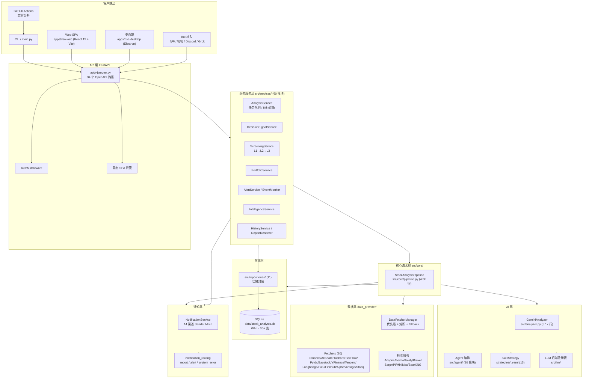
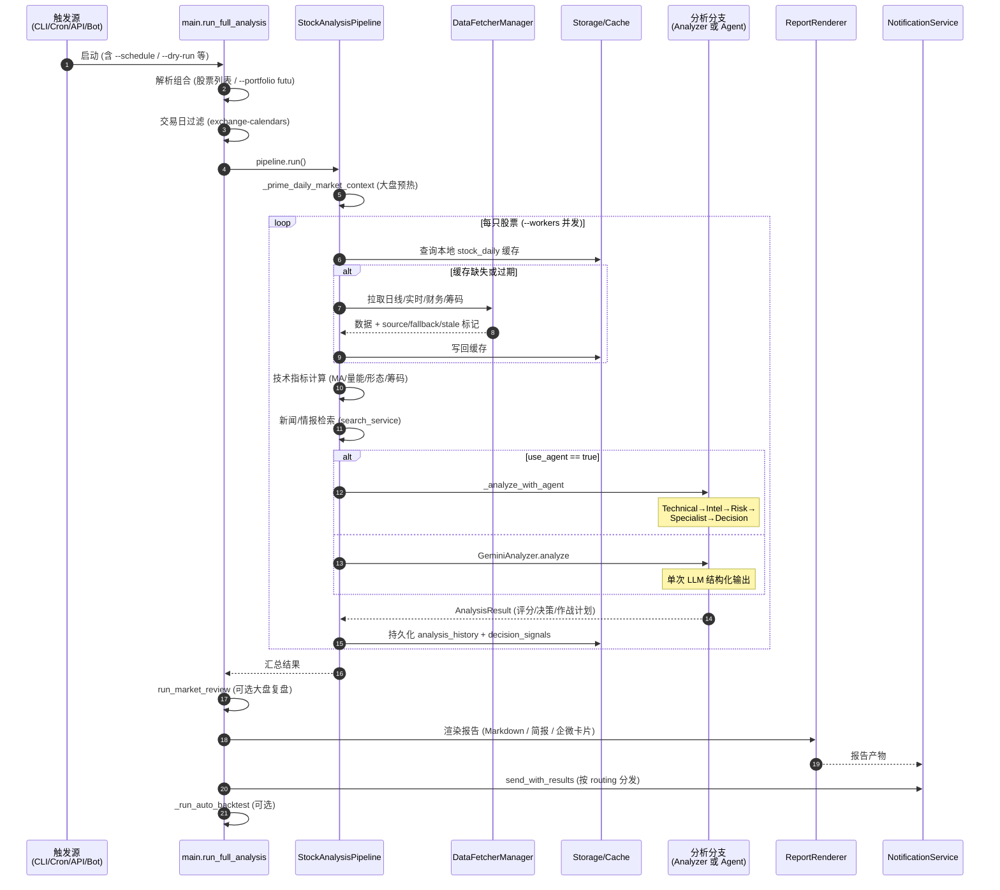
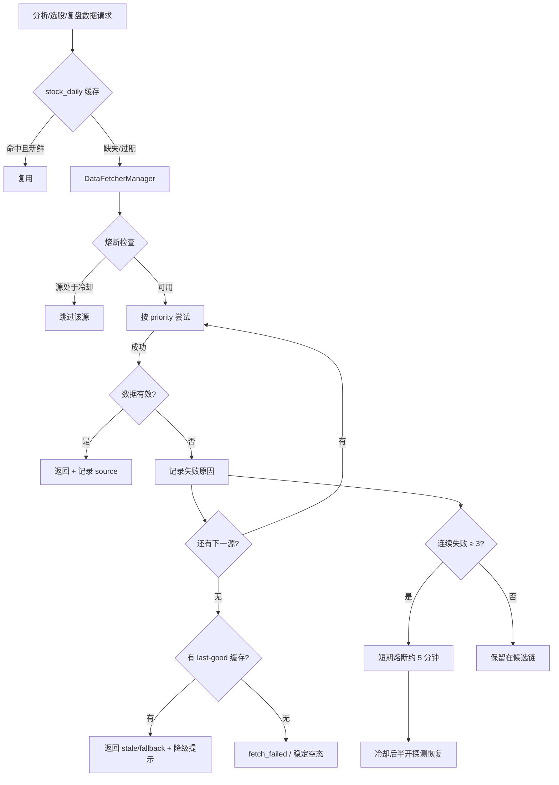
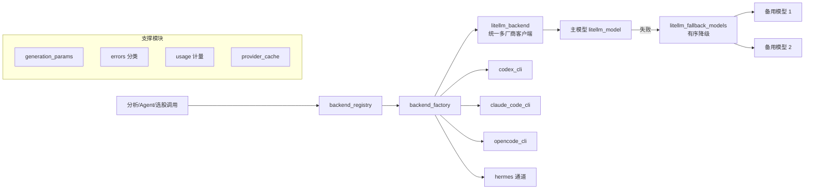
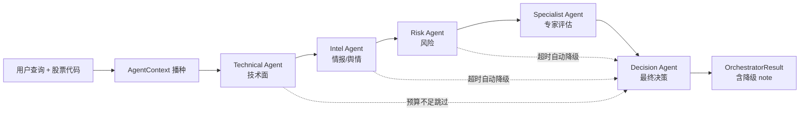
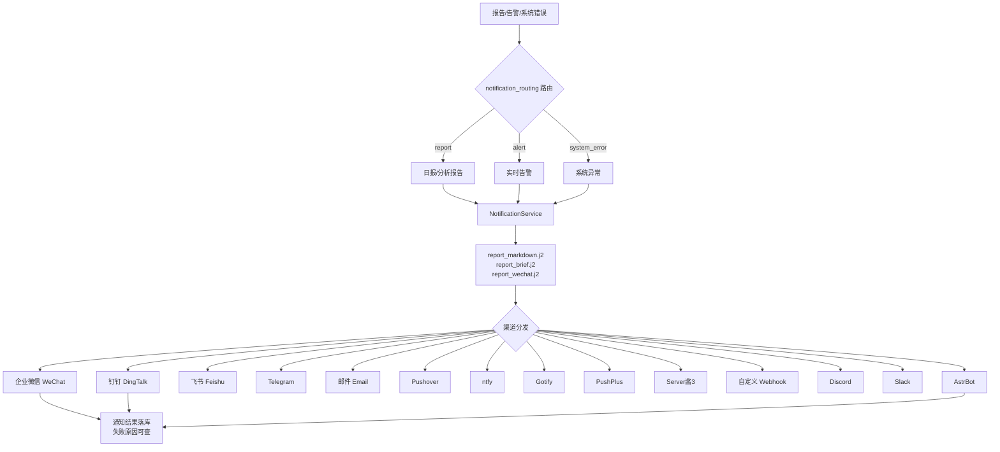
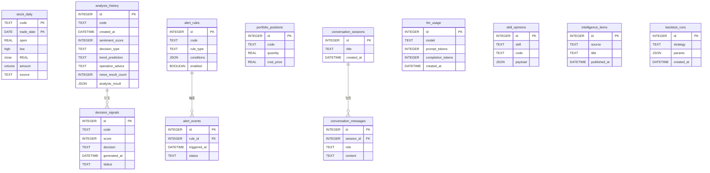
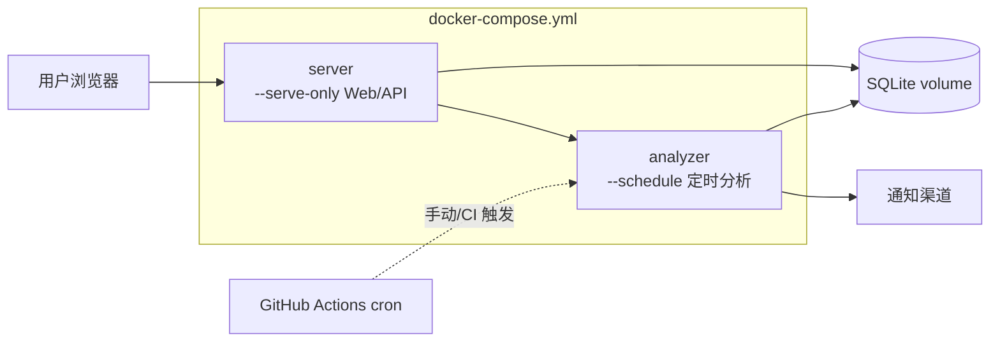

# Daily Stock Analysis (DSA) 系统架构文档

> 版本：v3.32.0 ｜ 文档生成：2026-10-17 ｜ 适用代码基线：`main` 分支
>
> 本文档面向开发者、部署者与二次集成方，完整描述 DSA 的分层结构、分析流水线、数据源降级、Agent/技能体系、通知推送、API 表面、存储模型与部署拓扑。
> 面向用户的配置与使用说明请见 [docs/INDEX.md](docs/INDEX.md)；数据源故障处理细节请见 [docs/data-source-stability.md](docs/data-source-stability.md)。

---

## 目录

1. [项目定位与能力矩阵](#1-项目定位与能力矩阵)
2. [总体架构](#2-总体架构)
3. [目录结构与模块边界](#3-目录结构与模块边界)
4. [核心分析流水线](#4-核心分析流水线)
5. [数据层：多源抓取与降级](#5-数据层多源抓取与降级)
6. [AI 层：LLM 后端与模型路由](#6-ai-层llm-后端与模型路由)
7. [Agent / Skill / Strategy 体系](#7-agent--skill--strategy-体系)
8. [业务服务层与仓储层](#8-业务服务层与仓储层)
9. [API 表面](#9-api-表面)
10. [客户端：Web / 桌面 / Bot](#10-客户端web--桌面--bot)
11. [通知推送体系](#11-通知推送体系)
12. [存储模型](#12-存储模型)
13. [调度、CI/CD 与部署](#13-调度cicd-与部署)
14. [测试与质量门禁](#14-测试与质量门禁)
15. [关键契约与版本化产物](#15-关键契约与版本化产物)
16. [模块清单与代码规模](#16-模块清单与代码规模)
17. [附录：常见入口速查](#17-附录常见入口速查)

---

## 1. 项目定位与能力矩阵

DSA（Daily Stock Analysis）是一套**多市场股票智能分析系统**，覆盖 A股、港股、美股、日股、韩股、台股。核心链路：

```
抓取行情/财务/新闻 → 技术分析 + 舆情检索 → LLM / Agent 决策 → 生成报告 → 多渠道通知推送
```

| 维度 | 能力 |
| --- | --- |
| 市场覆盖 | A股、港股、美股、日股、韩股、台股 |
| 分析模式 | 传统单次 LLM 分析（`GeminiAnalyzer`） / 多 Agent 流水线（Technical→Intel→Risk→Specialist→Decision） |
| 策略技能 | 15 个自然语言 YAML 策略（龙头、均线金叉、放量突破、缩量回踩、箱体震荡、缠论、波浪、情绪周期…） |
| 数据源 | 20+ 抓取器，多优先级 fallback + 熔断 |
| 通知渠道 | 14 种（企业微信/钉钉/飞书/Telegram/邮件/Pushover/ntfy/Gotify/PushPlus/Server酱3/自定义 Webhook/Discord/Slack/AstrBot） |
| 客户端 | Web（React 19）、桌面（Electron）、Bot（飞书/钉钉/Discord/Grok）、GitHub Actions、CLI |
| 存储 | SQLite（WAL）+ SQLAlchemy ORM，30+ 表 |
| 额外能力 | 决策信号池、实时告警、组合管理、L1-L3 选股、回测、情报聚合、用量统计、Agent 轨迹评估 |

### 1.1 决策评分契约（decision-scale-v1）

所有分析结论统一映射到 0–100 评分与五档决策：

| 区间 | 决策 | 含义 |
| --- | --- | --- |
| 80–100 | `strong_buy` | 强烈买入 |
| 60–79 | `buy` | 买入 |
| 40–59 | `watch` | 观望 |
| 20–39 | `reduce` | 减仓 |
| 0–19 | `sell` | 卖出 |

---

## 2. 总体架构



### 2.1 分层职责一句话

| 层 | 目录 | 职责 | 禁止事项 |
| --- | --- | --- | --- |
| 入口 | `main.py` | CLI 参数解析、调度循环、组合解析、市场复盘编排 | 不写业务逻辑 |
| API | `api/` | HTTP 契约、鉴权、静态托管 | 不直接访问 DatabaseManager |
| Bot | `bot/` | IM 命令解析与回调 | 不直接访问 DatabaseManager |
| 业务 | `src/services/` | 用例编排、任务队列、规则引擎 | 不直接拼 HTTP/不直接发通知渠道细节 |
| 仓储 | `src/repositories/` | 数据访问封装 | 不含业务规则 |
| 核心 | `src/core/` | 分析流水线编排 | — |
| AI | `src/analyzer.py`、`src/agent/`、`src/llm/` | LLM 调用、Agent 循环、技能路由 | 不感知 HTTP/IM |
| 数据 | `data_provider/` | 多源抓取、统一报价模型、熔断 | 不感知业务 |
| 存储 | `src/storage.py` | SQLAlchemy 模型与 DatabaseManager | — |
| 通知 | `src/notification*.py` | 多渠道推送 | — |
| 前端 | `apps/dsa-web` | React SPA | — |
| 桌面 | `apps/dsa-desktop` | Electron 壳 + PyInstaller 后端 | — |
| 运维 | `scripts/`、`.github/`、`docker/` | 构建、CI、部署 | — |

> 目录边界规则见根目录 `AGENTS.md`：后端改动限 `src/ data_provider/ api/ bot/`，Web 限 `apps/dsa-web`，桌面限 `apps/dsa-desktop`，部署限 `scripts/ .github/ docker/`。

---

## 3. 目录结构与模块边界

```
daily_stock_analysis/
├── main.py                     # CLI 主入口 (~1.9k 行)
├── src/
│   ├── core/
│   │   ├── pipeline.py         # StockAnalysisPipeline 核心流水线 (4.3k 行)
│   │   └── ...                 # 指数能力矩阵、上下文快照、市场复盘
│   ├── analyzer.py             # GeminiAnalyzer + AnalysisResult (5.1k 行)
│   ├── config.py               # Config 单例、模型/代理/渠道配置 (3.7k 行)
│   ├── storage.py              # DatabaseManager + 全部 ORM 模型 (4.3k 行)
│   ├── notification.py         # NotificationService + 14 渠道 Sender (3.1k 行)
│   ├── notification_routing.py # report / alert / system_error 路由
│   ├── llm/                    # LLM 后端注册表、工厂、litellm/codex/claude/opencode/hermes
│   ├── agent/                  # Agent 编排 (30 模块) + tools/ (18 工具)
│   ├── services/               # 业务服务 (60 模块)
│   ├── repositories/           # 数据仓储 (11 模块)
│   ├── schemas/                # 7 个契约 Schema
│   ├── search_service.py       # 多检索源注册与优先级
│   └── ...
├── data_provider/              # 数据抓取 (20 文件)
│   ├── base.py                 # BaseFetcher + DataFetcherManager
│   ├── realtime_types.py       # UnifiedRealtimeQuote + CircuitBreaker
│   ├── fundamental_adapter.py
│   └── fetchers/               # efinance / akshare / tushare / tickflow / ...
├── api/                        # FastAPI
│   ├── app.py                  # create_app / CORS / AuthMiddleware / SPA
│   └── v1/                     # router + endpoints/ (15 端点模块)
├── bot/                        # 飞书 / 钉钉 / Discord / Grok Bot
├── strategies/                 # 15 个自然语言 YAML 技能
├── templates/                  # Jinja2 报告模板
│   ├── report_markdown.j2      # 完整报告
│   ├── report_brief.j2         # 简报
│   ├── report_wechat.j2        # 企微卡片
│   └── _macros.j2              # 宏
├── apps/
│   ├── dsa-web/                # React 19 + Vite + Tailwind SPA
│   └── dsa-desktop/            # Electron 31 桌面壳
├── evals/agent_trajectory/     # Agent 轨迹评估 (metrics.py / run_eval.py / golden_samples.json)
├── tests/                      # 277 个测试文件 (unit / integration / network)
├── scripts/                    # ci_gate.sh、打包、运维脚本
├── docker/                     # Dockerfile (multi-stage) + docker-compose.yml
├── .github/workflows/          # 10 条流水线
└── docs/                       # 文档中心 (INDEX.md 为入口)
```

---

## 4. 核心分析流水线

### 4.1 端到端时序（单次定时分析）



### 4.2 分析分支选择（传统 vs Agent）

```mermaid
flowchart TD
    START[analyze_stock] --> CHK{分支判定}
    CHK -->|config.agent_mode = true| AG[_analyze_with_agent]
    CHK -->|请求携带 skills| AG
    CHK -->|agent_skills ≠ ['all']| AG
    CHK -->|否则| TRAD[GeminiAnalyzer.analyze<br/>单次 LLM 结构化输出]

    AG --> ORCH{编排模式}
    ORCH -->|quick| Q[Technical → Decision<br/>约 2 次 LLM 调用]
    ORCH -->|standard 默认| ST[Technical → Intel → Decision]
    ORCH -->|full| FU[Technical → Intel → Risk → Decision]
    ORCH -->|specialist| SP[Technical → Intel → Risk<br/>→ 专家评估 → Decision]

    Q --> OUT
    ST --> OUT
    FU --> OUT
    SP --> OUT
    TRAD --> OUT[AnalysisResult]

    OUT --> PACK[AnalysisContextPack 持久化<br/>PACK_VERSION 1.0]
```

关键源码锚点：

| 逻辑 | 位置 |
| --- | --- |
| 组合解析 / 交易日过滤 / 主入口 | `main.py` `run_full_analysis()` |
| 分支判定（agent vs 传统） | `src/core/pipeline.py` 约 L555–680 |
| Agent 分析入口 | `src/core/pipeline.py` `_analyze_with_agent()` |
| 多 Agent 编排 | `src/agent/orchestrator.py` `AgentOrchestrator` |
| Agent 单体循环 | `src/agent/runner.py` `run_agent_loop` |
| 工厂装配 | `src/agent/factory.py` `build_agent_executor` / `build_agent_chat_executor` |
| 结果模型 | `src/analyzer.py` `AnalysisResult` dataclass |
| 指数能力矩阵 / 模块跳过 | `src/core/pipeline.py` `INDEX_SKIP_MODULES` |

### 4.3 AnalysisResult 核心字段

```
sentiment_score      情绪评分 0-100
trend_prediction     趋势预测
operation_advice     操作建议
decision_type        strong_buy / buy / watch / reduce / sell
action               当前动作
dashboard            仪表盘聚合块
news_result_count    新闻三态：None(未检索)/0(零命中)/>0(正常)
```

---

## 5. 数据层：多源抓取与降级

### 5.1 统一架构



### 5.2 默认优先级链（`*_PRIORITY` 环境变量可覆盖）

| 场景 | 优先级链 | 说明 |
| --- | --- | --- |
| A股个股日线 | Efinance(P0) → AkShare(P1) → Tushare(P2) → TickFlow/Pytdx(P2) → Baostock(P3) → YFinance(P4) → Tencent(P5) | 配置 `TUSHARE_TOKEN` 后 Tushare 升至 -1（最优先） |
| A股已登记指数日线 | **固定链** Tencent → AkShare → TickFlow → YFinance | 不读取普通日 K 的 `*_PRIORITY` |
| A股实时行情 | `REALTIME_SOURCE_PRIORITY` 默认 Tencent → AkShare Sina → Efinance → AkShare EM | 可将 TickFlow/Tushare 提前 |
| A股大盘复盘 | TickFlow（有 `TICKFLOW_API_KEY`）→ AkShare → Tushare → Efinance | 与指数日线链是不同入口 |
| 港股 | Futu（配置 `FUTU_OPEND_HOST`）→ Longbridge → AkShare → YFinance | `FUTU_HK_REALTIME_SOURCE_PRIORITY` 控制实时顺序 |
| 美股 | Longbridge → YFinance → Finnhub/AlphaVantage（仅补字段）→ Stooq | Finnhub/AlphaVantage 不可独立返回实时报价 |
| 选股快照 | Tushare（有 token）→ Sina → Efinance → AkShare EM → EM Datacenter | source health 冷启动为 `unknown` |
| 选股热点题材 | EastMoney provider + last-good cache | 参考 AlphaSift 实现 |

### 5.3 数据能力只读契约

`GET /api/v1/data/overview`（别名 `/data/capabilities`）暴露三层只读结构，不触发外部请求、不返回密钥：

- **providers**：`enabled / configured / status / markets / datasets / dataset_markets / warnings`
- **datasets**：`quote.realtime / kline.daily / index.daily / market.overview / financial.snapshot / news.events / strategy.screening / alert.monitor / portfolio.account` 的 `status / source / fallback_from / stale / warnings`
- **priorities**：`cn.realtime / hk.realtime / us.realtime / daily.generic / cn.index.daily / market.overview / screening.snapshot / news.events` 当前顺序

状态取值：`unknown`（未探测）/ `unconfigured`（缺配置）/ `degraded`（前置源不可用但后续可消费）/ `ok`。

### 5.4 新闻检索源

`src/search_service.py` 注册顺序：**Anspire（插入优先）→ Bocha → Tavily → Brave → SerpAPI → MiniMax → SearXNG**。

报告层严格区分「未执行检索」（`news_result_count = None`）与「执行后零命中」（`0`），分别渲染不同披露文案，覆盖 dashboard / brief / 个股 / 日报四个渲染路径及历史 Markdown、分享图片、Web 报告详情。

---

## 6. AI 层：LLM 后端与模型路由



| 配置项 | 作用 |
| --- | --- |
| `litellm_model` | 主分析模型 |
| `litellm_fallback_models` | 主模型失败时的有序降级链 |
| `agent_litellm_model` | Agent 模式专用模型 |
| `LITELLM_CONFIG` (YAML) | 多渠道 LiteLLM 配置 |

所有 LLM 调用经统一计费（`src/llm/usage.py`）写入 `llm_usage` 表，供 Web「用量」页展示。错误统一分类（配额/鉴权/超时/内容过滤）以支撑自动降级与用户可读提示。

---

## 7. Agent / Skill / Strategy 体系

### 7.1 概念关系

| 概念 | 载体 | 说明 |
| --- | --- | --- |
| Skill（技能） | `strategies/*.yaml`（15 个） | 自然语言撰写的策略说明，注入 Prompt |
| Strategy（策略） | 同上 + `StrategyEngine` | 技能的执行与回测载体 |
| Tool（工具） | `src/agent/tools/` | 18 个可被 Agent 调用的只读工具 |
| Agent（智能体） | `AgentExecutor` / `AgentOrchestrator` | 工具调用循环 / 多阶段编排 |
| Memory | `src/agent/memory.py` `AgentMemory` | 跨轮记忆，供 `SkillAggregator` 计权 |

### 7.2 多 Agent 编排



编排模式（`AgentOrchestrator`）：

| 模式 | 阶段 | 特点 |
| --- | --- | --- |
| `quick` | Technical → Decision | 最快，约 2 次 LLM 调用 |
| `standard`（默认） | Technical → Intel → Decision | 平衡 |
| `full` | Technical → Intel → Risk → Decision | 含风险评估 |
| `specialist` | Technical → Intel → Risk → 专家评估 → Decision | 最完整 |

超时/预算不足时**不硬中断**，而是基于已完成阶段自动生成降级结论（`note="多 Agent 超时/预算不足，以下结论基于已完成阶段自动降级生成。"`）。每个阶段有最小预算阈值（`stage_min_budget_s`），避免预算不足仍启动阶段浪费计费。

### 7.3 18 个 Agent 工具

| 分类 | 工具 |
| --- | --- |
| 技术分析 | `analyze_trend`、`calculate_ma`、`get_volume_analysis`、`analyze_pattern` |
| 行情/历史 | `get_realtime_quote`、`get_daily_history`、`get_chip_distribution` |
| 上下文/信息 | `get_analysis_context`、`get_stock_info`、`get_portfolio_snapshot` |
| 资金/市场 | `get_capital_flow`、`get_market_indices`、`get_sector_rankings` |
| 回测 | `get_skill_backtest_summary`、`get_strategy_backtest_summary`、`get_stock_backtest_summary` |
| 检索 | `search_comprehensive_intel`、`search_stock_news` |

### 7.4 15 个策略技能（strategies/）

| 文件 | 策略 |
| --- | --- |
| `dragon_head.yaml` | 龙头战法 |
| `ma_golden_cross.yaml` | 均线金叉 |
| `volume_breakout.yaml` | 放量突破 |
| `shrink_pullback.yaml` | 缩量回踩 |
| `box_oscillation.yaml` | 箱体震荡 |
| `bull_trend.yaml` | 多头趋势 |
| `chan_theory.yaml` | 缠论 |
| `wave_theory.yaml` | 波浪理论 |
| `emotion_cycle.yaml` | 情绪周期 |
| `hot_theme.yaml` | 热点题材 |
| `event_driven.yaml` | 事件驱动 |
| `expectation_repricing.yaml` | 预期重定价 |
| `growth_quality.yaml` | 成长质量 |
| `one_yang_three_yin.yaml` | 一阳穿三阴 |
| `bottom_volume.yaml` | 底部放量 |

### 7.5 选股引擎（Screening）

源自 AlphaSift 思路，三级流水：

```
L1 硬过滤（技术/基本面阈值）
  → L2 LLM 排序（结合技能 Prompt）
    → L3 深度后分析（生成完整 AnalysisResult）
```

---

## 8. 业务服务层与仓储层

### 8.1 services/（60 模块）

| 分组 | 主要模块 |
| --- | --- |
| 分析编排 | `analysis_service`、`run_flow`、`run_diagnostics`、`runtime_scheduler`、`task_queue/task_service` |
| 决策信号 | `decision_signal_*`（生成、后验、通知联动） |
| 告警 | `alert_*`（规则、事件监控、冷却） |
| 组合 | `portfolio_*`（持仓、风险） |
| 选股 | `screening_service`、`services/screening/` |
| 技能意见 | `skill_opinion_*` |
| 历史/报告 | `history_*`、`report_renderer` |
| 市场/情报 | `market_light_*`、`intelligence_service` |
| 配置 | `system_config_service` |
| 用量 | usage 相关服务 |

### 8.2 repositories/（11 模块）

`alert` / `analysis` / `backtest` / `decision_signal(+outcome)` / `intelligence` / `portfolio` / `skill_opinion(+outcome)` / `stock` —— 各自封装 `DatabaseManager` 访问，**api/bot 只能经 services → repositories 触达数据库**。

---

## 9. API 表面

FastAPI，`api/app.py` 的 `create_app` 装配 CORS + `AuthMiddleware` + 静态 SPA 托管。OpenAPI 规格产物：[docs/architecture/api_spec.json](docs/architecture/api_spec.json)（34 条路径，title: *Daily Stock Analysis API 1.0.0*）。

| 路径前缀 | 能力 |
| --- | --- |
| `/api/v1/auth` | 登录 / Token |
| `/api/v1/agent` | Agent 对话、技能、多 Agent 任务 |
| `/api/v1/analysis` | 触发分析、任务流（SSE）、结果 |
| `/api/v1/history` | 历史分析、报告详情 |
| `/api/v1/stocks` | 股票搜索、个股画像（stock-profile） |
| `/api/v1/backtest` | 回测任务与汇总 |
| `/api/v1/system` | 系统配置、数据源能力、诊断 |
| `/api/v1/usage` | LLM 用量统计 |
| `/api/v1/portfolio` | 组合与持仓 |
| `/api/v1/alerts` | 告警规则、事件、冷却 |
| `/api/v1/decision-signals` | 决策信号池 |
| `/api/v1/screening` | 选股与热点 |
| `/api/v1/data` | 数据能力只读契约（overview/capabilities） |
| `/api/v1/intelligence` | 资讯/情报源 |
| `/health` | 健康检查 |

---

## 10. 客户端：Web / 桌面 / Bot

### 10.1 Web（`apps/dsa-web`）

React 19 + Vite + Tailwind。路由页面：

| 页面 | 路径关键词 | 能力 |
| --- | --- | --- |
| Home | `/` | 仪表盘总览 |
| Chat | `/chat` | Agent 对话（SSE 任务流） |
| Portfolio | `/portfolio` | 组合管理 |
| DecisionSignals | `/decision-signals` | 决策信号池 |
| Screening | `/screening` | 选股 |
| Backtest | `/backtest` | 回测 |
| Alerts | `/alerts` | 告警中心 |
| Usage | `/usage` | 用量统计 |
| Settings | `/settings` | 系统配置 |
| Login | `/login` | 登录 |

关键 hooks：`useTaskStream`（SSE）、`useSystemConfig` 等；API 封装于 `src/api/*.ts`。

### 10.2 桌面端（`apps/dsa-desktop`）

Electron 31 + electron-builder。启动时拉起 **PyInstaller 冻结的 Python 后端**，前端指向本地服务，实现「小白客户端」双击即用。

### 10.3 Bot 接入

| 平台 | 入口 | 说明 |
| --- | --- | --- |
| 飞书 | `bot/` + lark-oapi | 卡片交互、命令 |
| 钉钉 | dingtalk-stream | Stream 模式回调 |
| Discord | discord.py + PyNaCl | Bot 命令 + Webhook 签名校验 |
| Grok Bot | REST 对接 | 外部 AI teammate 调用 DSA REST / DecisionSignal / Skill |

Bot 层只解析命令并调用 services，不直接访问数据库。

---

## 11. 通知推送体系



- `NotificationService` 通过 **Mixin 继承全部 Sender**（`src/notification.py` L257 起），`NotificationChannel` 枚举 14 个渠道。
- 三种路由类型：`report` / `alert` / `system_error`（`src/notification_routing.py`）。
- 核心方法：`send` / `send_with_results` / `generate_aggregate_report` / `save_report_to_file`。
- 报告渲染走 Jinja2 模板（`templates/`），支持 Markdown 完整版、简报版、企微卡片版。
- 通知结果（含失败原因）持久化，可在 Web 端查看。

---

## 12. 存储模型

SQLite `data/stock_analysis.db`（**WAL 模式**）+ SQLAlchemy 2.x ORM，全部模型定义于 `src/storage.py`（`DatabaseManager` 约 L1310 起）。



> 完整 30+ 表还包括：`decision_signal_outcomes`、`skill_opinion_outcomes`、`market_light_*`、`alert_*` 派生表、`stock_profile` 缓存、`research_artifact` 等。以 `src/storage.py` 中的 ORM 定义为准。

关键设计：

- **日线缓存优先**：`stock_daily` 命中且新鲜则不请求外部源。
- **分析结果全量持久化**：`analysis_history` 存完整 `AnalysisResult` JSON，保证实时与历史报告一致（含 `news_result_count` 三态）。
- **决策信号独立池**：`decision_signals` 支持后验评估（`*_outcomes`）。

---

## 13. 调度、CI/CD 与部署

### 13.1 运行模式（main.py 标志）

| 标志 | 作用 |
| --- | --- |
| `--schedule` | 守护式定时调度（Docker analyzer 镜像默认） |
| `--no-run-immediately` | 启动时不立即跑一次 |
| `--force-run` | 忽略交易日历强制执行 |
| `--serve` / `--serve-only` | 启动 Web 服务（Docker server 镜像默认） |
| `--port` / `--host` | 服务监听 |
| `--stocks` / `--portfolio futu` | 指定股票列表 / 从 Futu 导入持仓 |
| `--workers` | 并发分析数 |
| `--dry-run` / `--no-notify` | 试运行 / 不推送 |
| `--market-review` / `--no-market-review` | 大盘复盘开关 |
| `--backtest*` | 回测相关 |
| `--webui` / `--webui-only` | 启动 Web UI |

### 13.2 GitHub Actions（10 条流水线）

| 工作流 | 作用 |
| --- | --- |
| `00-daily-analysis.yml` | **核心定时分析**：cron `0 10 * * 1-5` UTC（北京 18:00） |
| `ci.yml` | ai-governance + backend-gate + docker-build + web-gate + 桌面打包 |
| `desktop-release.yml` | 桌面端发布 |
| `docker-publish.yml` / `ghcr-dockerhub.yml` | 镜像发布 |
| `create-release.yml` / `auto-tag.yml` | 发版与自动打标 |
| `network-smoke.yml` | 网络冒烟 |
| `pr-review.yml` | PR 检查 |
| `stale.yml` | 过期 Issue 清理 |

### 13.3 Docker 部署拓扑



- `docker/Dockerfile`：multi-stage（node 构建前端 + python 后端）。
- `docker/entrypoint.sh`：入口封装。
- 也可部署至云服务器 / Zeabur（见 [docs/DEPLOY.md](docs/DEPLOY.md)、[docs/deploy-webui-cloud.md](docs/deploy-webui-cloud.md)、[docs/docker/zeabur-deployment.md](docs/docker/zeabur-deployment.md)）。

---

## 14. 测试与质量门禁

| 项 | 说明 |
| --- | --- |
| 测试文件 | **277** 个（`tests/`） |
| 标记 | `unit` / `integration` / `network`（定义于 `setup.cfg`） |
| 本地门禁 | `./scripts/ci_gate.sh` |
| 快速单测 | `pytest -m "not network"` |
| Lint | flake8（`max-line-length = 120`） |
| Agent 轨迹评估 | `evals/agent_trajectory/`：`metrics.py`（纯函数打分）+ `run_eval.py` + `golden_samples.json` |
| AI 治理 | CI `ai-governance` 检查 |

---

## 15. 关键契约与版本化产物

| 契约 | 版本 | 位置/说明 |
| --- | --- | --- |
| decision-scale-v1 | v1 | 80–100 strong_buy / 60–79 buy / 40–59 watch / 20–39 reduce / 0–19 sell |
| AnalysisContextPack | `PACK_VERSION "1.0"` | 分析上下文包，P1–P6 契约见 [docs/analysis-context-pack.md](docs/analysis-context-pack.md) |
| market-structure-v1 | v1 | 市场结构描述 |
| ResearchArtifact | — | 结构化研究产物：Thesis / Evidence / Invalidation / Next Action / Data Quality（见 [docs/research-artifact.md](docs/research-artifact.md)） |
| stock-profile | — | 单一 stock-profile 契约、分块质量状态（见 [docs/stock-profile-api.md](docs/stock-profile-api.md)） |
| data overview | — | 数据能力只读契约（providers / datasets / priorities） |
| OpenAPI | 1.0.0 | `docs/architecture/api_spec.json`（34 路径） |
| news_result_count 三态 | — | `None` 未检索 / `0` 零命中 / `>0` 正常；影响报告披露文案 |

---

## 16. 模块清单与代码规模

| 维度 | 数量 |
| --- | --- |
| Python 文件总数 | **629** |
| `src/` Python 文件 | **240** |
| 测试文件 | **277** |
| `src/services/` 模块 | **60** |
| `src/agent/` 模块 | **30** |
| `src/repositories/` 模块 | **11** |
| `data_provider/` 文件 | **20** |
| 策略技能 YAML | **15** |
| Agent 工具 | **18** |
| 通知渠道 | **14** |
| API 路径 | **34** |
| 数据库表 | **30+** |
| GitHub Actions 工作流 | **10** |
| 报告 Jinja 模板 | **4** |
| 契约 Schema | **7** |

### 大文件热点（维护时优先关注）

| 文件 | 约行数 | 职责 |
| --- | --- | --- |
| `src/analyzer.py` | 5,124 | LLM 分析与 `AnalysisResult` |
| `src/storage.py` | 4,372 | ORM 模型 + `DatabaseManager` |
| `src/core/pipeline.py` | 4,377 | 分析流水线 |
| `src/config.py` | 3,755 | 配置单例 |
| `src/notification.py` | 3,115 | 通知服务 + 14 渠道 |
| `main.py` | ~1,900 | CLI 入口 |

---

## 17. 附录：常见入口速查

### 我想改…

| 目标 | 入口 |
| --- | --- |
| 加一个数据源 | `data_provider/fetchers/` 新增 `BaseFetcher` 子类，注册进 `DataFetcherManager`，在 `.env.example` 增加 `*_PRIORITY` |
| 加一个通知渠道 | `src/notification.py` 新增 Sender Mixin + `NotificationChannel` 枚举，补 `docs/notifications.md` |
| 加一个 Agent 工具 | `src/agent/tools/` 对应分类下注册，补 `tool_surface.py` |
| 加一个策略技能 | `strategies/*.yaml` 新文件（自然语言），必要时补回测 |
| 加一个 API 端点 | `api/v1/endpoints/` + `api/v1/router.py`，更新 `docs/architecture/api_spec.json` |
| 加一个配置项 | `src/config.py` + `.env.example` + `docs/full-guide.md` |
| 改报告样式 | `templates/*.j2` |
| 改决策评分规则 | decision-scale-v1 契约 + `src/analyzer.py` |
| 调数据源优先级 | 环境变量 `*_PRIORITY` / `REALTIME_SOURCE_PRIORITY` |

### 协作约束（摘自 AGENTS.md）

- **未经明确确认不得** `git commit` / `tag` / `push`。
- 提交信息使用**英文**；按仓库规范添加署名行。
- 不硬编码密钥、绝对路径、模型名、端口。
- 新增配置必须同步 `.env.example`；README.md 保持精简。
- 目录边界：后端 `src/ data_provider/ api/ bot/`；Web `apps/dsa-web`；桌面 `apps/dsa-desktop`；部署 `scripts/ .github/ docker/`。

### 相关文档

| 文档 | 内容 |
| --- | --- |
| [docs/INDEX.md](docs/INDEX.md) | 文档中心入口 |
| [docs/full-guide.md](docs/full-guide.md) | 完整配置与部署指南 |
| [docs/data-source-stability.md](docs/data-source-stability.md) | 数据源矩阵与降级图 |
| [docs/LLM_CONFIG_GUIDE.md](docs/LLM_CONFIG_GUIDE.md) | LLM 渠道三层配置 |
| [docs/notifications.md](docs/notifications.md) | 通知能力基线 |
| [docs/decision-signals.md](docs/decision-signals.md) | 决策信号专题 |
| [docs/analysis-context-pack.md](docs/analysis-context-pack.md) | 上下文包契约 |
| [docs/architecture/api_spec.json](docs/architecture/api_spec.json) | OpenAPI 规格 |
| [AGENTS.md](AGENTS.md) | AI 协作规则与目录边界 |
